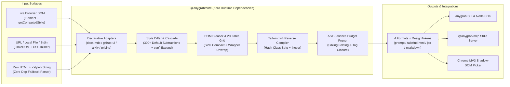

<div align="center">

# AnyGrab

**Token-Budget-Aware DOM & UI Context Distillation Engine for Coding Agents, Browser-Use & RAG**

*Turn 27,000+ tokens of bloated CSS-in-JS, inline SVGs, and `<div>` soup into `<600` tokens of clean Tailwind v4 HTML, React JSX, GFM Tables, or structured AI Prompts — deterministically in `4.2ms` with `0` LLM calls.*

[](./.github/workflows/ci.yml)
[](./LICENSE)
[](./packages/core/package.json)
[](./tsconfig.base.json)
[](./packages/mcp)

**[English](./README.md)** · **[简体中文](./README.zh-CN.md)** · **[AnyGrab-Bench](#anygrab-bench-v010-results)** · **[MCP Setup](#mcp-server-setup-antigravity--claude-code--cursor--codex)** · **[Contributing](./CONTRIBUTING.md)** · **[12 Good First Issues](./docs/GOOD_FIRST_ISSUES.md)**

</div>

---

## Why AnyGrab?

Modern AI Coding Agents (**Antigravity**, **Claude Code**, **Cursor**, **Codex**) and Browser-Use pipelines choke on real-world web DOMs:

- Dumping `outerHTML` + `getComputedStyle()` on a single SaaS pricing section explodes into **27,397 tokens** of browser default CSS resets, obfuscated `css-19x82a` hashes, 4KB inline `<svg>` paths, and 20-deep wrapper `<div>`s — rotting your context window.
- Article extractors (`Readability`, `defuddle`, `Turndown`) strip **100% of visual layout, Flexbox/Grid structure, design tokens, and interactive ARIA controls**, and frequently mangle complex `rowspan`/`colspan` data tables.
- Dev-server tools (`react-grab`) require local React Fiber instrumentation and cannot inspect **arbitrary external production webpages** or static HTML snapshots.

**AnyGrab** bridges that gap as a **zero-dependency, deterministic TypeScript compiler** (`@anygrab/core`) paired with a **1-line CLI**, **Stdio MCP Server**, **Chrome MV3 Shadow-DOM Picker**, and **Interactive Benchmark Playground**:

```text
Raw SaaS Pricing HTML + Computed CSS :  27,397 tokens  (noisy resets, 13 giant SVGs, css-19x82a)
AnyGrab Default (Lossless UI + CSS)  :   1,785 tokens  (100/100 fidelity, clean Tailwind v4 / JSX)
AnyGrab (--budget 600)               :     235 tokens  (AST salience folded, 100% valid tag closure)
```

---

## 3-Line Quick Start

```bash
# 1. Distill any public URL into a 1,200-token AI prompt (auto-inlines external <link> CSS!)
npx anygrab https://example.com --selector "main" --budget 1200

# 2. Convert a local HTML component into clean React JSX + :hover Tailwind utilities
npx anygrab ./pricing.html --format jsx --hover -o PricingSection.tsx

# 3. Extract structured Design Tokens (colors, fonts, radii, shadows, spacings) as JSON
npx anygrab https://example.com --tokens-only
```

> Telemetry prints cleanly to `stderr` (`✔ AnyGrab: 7,828 → 235 tokens (-97.00%) · 3.7ms`) so `stdout` stays 100% pipe-safe (`| pbcopy`, `> context.md`).

---

## Ecosystem Comparison Matrix

| Capability | **AnyGrab** (`MIT`) | `react-grab` (`MIT`) | `defuddle` / `Readability` | `Turndown` | `DivMagic` (`Paid`) |
| :--- | :---: | :---: | :---: | :---: | :---: |
| **Works on any external live webpage** | ✅ Yes | ❌ Local React dev only | ✅ Yes | ✅ Yes | ✅ Yes |
| **Zero-dependency JS/Edge/Browser core** | ✅ `0` deps | ⚠️ Browser runtime | ✅ Lightweight | ✅ Lightweight | ❌ Proprietary |
| **CSS → Tailwind v4 reverse compiler** | ✅ Built-in + `:hover` | ❌ Source file lookup | ❌ Strips all CSS | ❌ `0%` style recall | ✅ Yes |
| **Token-budget AST folding (`--budget`)** | ✅ Lossless closure | ❌ No | ❌ No | ❌ No | ❌ No |
| **2D `rowspan` + `colspan` table matrix** | ✅ `100%` aligned | ❌ N/A | ⚠️ Partial HTML | ❌ Breaks merged cells | ⚠️ HTML only |
| **CLI + Node SDK + MCP Server included** | ✅ All 3 built-in | ⚠️ Dev bridge | ⚠️ Library / CLI | ⚠️ Library only | ❌ Extension/Web |
| **Runtime LLM cost & latency** | **`$0` · `~4.2 ms`** | `$0` · Instant | `$0` · Fast | `$0` · `~1.9 ms` | Paid subscription |

---

## `AnyGrab-Bench` v0.1.0 Results

Evaluated deterministically (`0` LLM calls) across **10 synthetic MIT DOM Torture Fixtures** covering CSS-in-JS hash soup, 13× multi-stop gradient SVGs, `rowspan`/`colspan` financial statements, 20-layer `<div>` wrappers, ARIA modals, Kanban sibling lists, and LaTeX academic tables.

Reproduce locally anytime with `pnpm bench` (source data: [`benchmarks/results/latest.json`](./benchmarks/results/latest.json)):

### Aggregate Baseline Summary (10 Fixtures)

| Baseline Method | Total Tokens | Avg Tokens | Token Savings | Avg Latency | Fidelity (0–100) | Style Recall | Table / Struct |
| :--- | ---: | ---: | ---: | ---: | ---: | ---: | ---: |
| Raw HTML + CSS | 31,298 | 3,130 | -0.0% | 0.01 ms | 86.2 / 100 | 62.4% | 93.2% |
| Naive Style Picker | 119,176 | 11,918 | +280.8% | 0.78 ms | 84.0 / 100 | 53.3% | 94.8% |
| Turndown (GFM) | 2,360 | 236 | -92.5% | 1.89 ms | 51.6 / 100 | 0.0% | 91.6% |
| **AnyGrab (Default)** | **12,697** | **1,270** | **-59.4%** | **4.23 ms** | **99.6 / 100** | **98.6%** | **100.0%** |
| **AnyGrab (`--budget 600`)** | **4,694** | **469** | **-85.0%** | **3.74 ms** | **83.4 / 100** | **94.6%** | **92.6%** |

> **Key Takeaways:**
> - **`AnyGrab (Default)`** achieves **`99.6 / 100`** overall fidelity (**100/100 on 9 of 10 torture fixtures**, with `100.0%` text recall, `98.6%` layout/style recall, `100.0%` merged-table integrity, and `100.0%` interactive control preservation) while cutting **`59.4%`** of raw HTML tokens and **`89.3%`** vs. naive computed-style pickers (`119,176 → 12,697` tokens) in **`4.23 ms`**.
> - **`AnyGrab (--budget 600)`** enforces a strict 600-token ceiling via AST salience sibling folding, cutting **`85.0%`** vs. raw HTML (**`96.1%`** vs. naive style pickers, averaging **`469` tokens**) while maintaining **`94.6%`** style recall and **`92.6%`** structural tag closure (`83.4 / 100` fidelity vs. Turndown's `51.6 / 100` and `0.0%` style recall).

<details>
<summary><strong>View Full 10-Fixture Breakdown (Tokens & Fidelity Score)</strong></summary>

| # | Torture Fixture | Raw HTML | Naive Picker | Turndown GFM | AnyGrab Default | AnyGrab (`B=600`) |
| :- | :--- | ---: | ---: | ---: | ---: | ---: |
| 1 | SaaS 3-Tier Gradient Pricing | 7828t (72.8) | 27397t (75.6) | 237t (53.8) | **1785t (100)** | **235t (59.8)** |
| 2 | Merged-Header Financial Statement | 2645t (81.3) | 9786t (87.7) | 185t (49) | **1543t (100)** | **483t (71.8)** |
| 3 | Bento KPI Dashboard (20x Div Soup) | 2351t (81.4) | 8397t (80.2) | 94t (52.5) | **794t (100)** | **598t (92.5)** |
| 4 | OAuth & Credentials Auth Modal | 1690t (91.3) | 5945t (84.7) | 76t (53) | **735t (100)** | **256t (71.4)** |
| 5 | API Reference Docs + TS Code | 1441t (91.6) | 9606t (85) | 511t (48.2) | **830t (95.7)** | **590t (92.7)** |
| 6 | Kanban Column (10 Isomorphic Cards) | 5778t (82.9) | 24817t (81.4) | 290t (55) | **2130t (100)** | **593t (96.6)** |
| 7 | Dark AI Hero + Decorative Blobs | 1239t (91.5) | 2889t (86.1) | 90t (62.5) | **367t (100)** | **367t (100)** |
| 8 | 20-Row Capability Matrix Table | 6173t (82.6) | 19474t (86.2) | 416t (54.6) | **2361t (100)** | **503t (88.9)** |
| 9 | Multi-Section Settings Form | 1173t (92.2) | 4341t (85.6) | 179t (39.7) | **942t (100)** | **474t (75.1)** |
| 10 | Academic Paper + Theorem & Ablations | 980t (94) | 6524t (87.4) | 282t (47.8) | **1210t (100)** | **595t (85.4)** |

</details>

---

## Architecture



---

## Programmatic SDK (`@anygrab/core` & `anygrab`)

### Universal Zero-Dependency Core (Browser / Edge / Cloudflare Workers / Node)

```ts
import { grab, extractDesignTokens } from '@anygrab/core';

const result = grab(document.querySelector('#pricing-tier')!, {
  format: 'prompt',         // 'prompt' | 'tailwind-html' | 'jsx' | 'markdown'
  locale: 'en',             // 'en' | 'zh-CN' (ready-to-paste bilingual AI replication prompts)
  maxTokens: 800,           // AST salience budget folding (never breaks closing tags!)
  compactSvg: true,         // Collapses multi-KB <svg> paths into semantic placeholders
  preserveTables: true,     // 2D virtual grid expansion for rowspan/colspan tables
  includeHoverStyles: true, // Emits hover:* Tailwind utilities
  styleResolver: (el, pseudo) => window.getComputedStyle(el, pseudo),
});

console.log(result.output);       // Clean React JSX snippet
console.log(result.designTokens); // { colors, fonts, radii, shadows, spacings }
console.log(result.metrics);      // { rawTokens, outputTokens, compressionRatio, durationMs, ... }
```

### Node.js URL & File Loader (`anygrab`)

```ts
import { grabFromUrl, grabFromFile } from 'anygrab';

// Automatically fetches & inlines external <link rel="stylesheet"> CSS (4s timeout guard)
const res = await grabFromUrl('https://example.com', {
  selector: 'main',
  format: 'prompt',
  maxTokens: 1200,
});
```

---

## MCP Server Setup (Antigravity / Claude Code / Cursor / Codex)

`@anygrab/mcp` exposes **3 local Stdio tools** (`grab_url`, `grab_html`, `extract_design_tokens`) with zero cloud keys required:

### Antigravity / Cursor / Claude Desktop (`mcp_config.json` / `.cursor/mcp.json`)

```json
{
  "mcpServers": {
    "anygrab": {
      "command": "npx",
      "args": ["-y", "@anygrab/mcp"]
    }
  }
}
```

### Claude Code CLI

```bash
claude mcp add anygrab -- npx -y @anygrab/mcp
```

### OpenAI Codex CLI (`~/.codex/config.toml`)

```toml
[mcp_servers.anygrab]
command = "npx"
args = ["-y", "@anygrab/mcp"]
```

| MCP Tool | Description |
| :--- | :--- |
| `grab_url` | Fetches a public HTTP(S) URL, inlines external `<link rel="stylesheet">` CSS, scopes to `selector`, and returns budgeted `prompt` / `tailwind-html` / `jsx` / `markdown` + telemetry. |
| `grab_html` | Distills raw HTML + `<style>` fragments directly into clean Tailwind/JSX/Markdown within `maxTokens`. |
| `extract_design_tokens` | Extracts deduplicated `colors`, `fonts`, `radii`, `shadows`, and `spacings` JSON from any `url` or `html`. |

---

## Chrome MV3 Visual Picker Extension (`apps/extension`)

Inspect and grab any live component in **one click** with zero host-page CSS pollution (mounted inside an isolated Open Shadow Root `#__anygrab-host__`, requesting only `activeTab`, `scripting`, `storage`, `clipboardWrite` — **no `<all_urls>`**):

- **Bilingual Out-of-the-Box (`中文 / EN`):** Ships with Chrome `_locales` (`en` + `zh_CN`), auto-detects browser language, and lets you switch `中 / EN` anytime from the Popup or floating HUD — generating localized AI prompts (`locale: 'zh-CN' | 'en'`) ready to paste straight into **Antigravity / Codex / Cursor**.
- **Built-in 30-Second Interactive Practice Arena (`guide.html`):** Click **How to Use & Practice Arena** inside the Popup to open a self-contained visual tutorial with live Pricing Card & Merged Financial Table practice targets so anyone can master picking in 30 seconds.

**3-Step Local Load:**
1. Build the workspace: `pnpm install && pnpm build`
2. Open `chrome://extensions` in Chrome / Arc / Brave / Edge and enable **Developer mode**.
3. Click **Load unpacked** and select `/path/to/anygrab/apps/extension/dist`.

**Keyboard HUD Workflow (`Alt+Shift+G`):**
- `Hover`: Live indigo bounding box + `<tag.class> · W×H px · ~N tokens` pill
- `ArrowUp` / `ArrowDown`: Expand selection to parent container or drill back down
- `Tab`: Cycle output format (`AI Prompt` → `Tailwind HTML` → `React JSX` → `Markdown`)
- `Click` or `Enter`: Distill & copy straight to clipboard + actionable paste toast + local `Recent Grabs` history
- `Escape`: Cleanly unmount Shadow Root with zero page residue

---

## Bilingual Official Website, Playground & Leaderboard (`apps/playground`)

Run the zero-backend 5-section Official Website (**Overview** · **AI Workflows** · **Live Playground** · **AnyGrab-Bench Leaderboard** · **Quick Start & Install**) locally:

```bash
pnpm playground
```

Switch seamlessly between **English / 简体中文**, copy battle-tested **Antigravity / Codex / Cursor** workflow prompts, paste dirty HTML+CSS on the left, drag the **Token Budget (`200`–`4,000`)** slider, compare **Original vs. Tailwind Live Sandbox Previews**, and inspect extracted **Design Token Swatches**.

---

## Community Adapters & Contributing

AnyGrab ships with 4 built-in public standard adapters (`docs-mdx`, `github-ui`, `arxiv-paper`, `marketing-pricing`) and a declarative **`AnyGrabAdapter` plugin interface** designed so anyone can add support for a documentation framework or UI kit in **under 30 lines of TypeScript**.

- Read the **30-Line Adapter Tutorial** in [`CONTRIBUTING.md`](./CONTRIBUTING.md)
- Pick one of **12 scoped starter tasks** in [`docs/GOOD_FIRST_ISSUES.md`](./docs/GOOD_FIRST_ISSUES.md)

---

## License

[MIT License](./LICENSE) © 2026 botshen & AnyGrab Contributors
