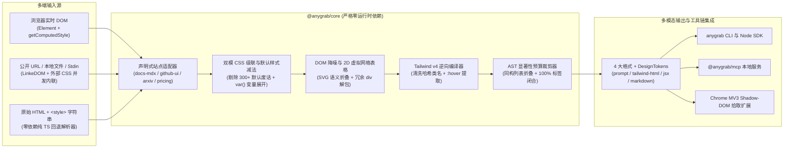

<div align="center">

# AnyGrab

**面向 AI Coding Agent、Browser-Use 与 RAG 的「Token 预算感知型」网页 DOM / UI 结构化蒸馏引擎**

*在 `4.2ms` 内、**`0` 大模型调用成本**下，将 `27,000+` Token 的臃肿 CSS-in-JS 乱码类名、超长内联 SVG 与 20 层嵌套 `<div>` 汤，无损提纯为 `<600` Token 的地道 Tailwind v4 HTML、React JSX、跨行跨列 GFM 表格或高信噪比 AI Prompt。*

[](./.github/workflows/ci.yml)
[](./LICENSE)
[](./packages/core/package.json)
[](./tsconfig.base.json)
[](./packages/mcp)

**[English](./README.md)** · **[简体中文](./README.zh-CN.md)** · **[AnyGrab-Bench 跑分榜](#anygrab-bench-v010-实测跑分榜)** · **[MCP 一键接入](#mcp-服务配置antigravity--claude-code--cursor--codex)** · **[贡献指南](./CONTRIBUTING.md)** · **[12 个新手任务](./docs/GOOD_FIRST_ISSUES.md)**

</div>

---

## 为什么需要 AnyGrab？

在使用 **Antigravity**、**Claude Code**、**Cursor**、**Codex** 进行前端复刻，或构建 **Browser-Use / RAG** 管道时，真实网页 DOM 是最大的上下文杀手：

- 直接导出 `outerHTML` + `getComputedStyle()`：仅一个 SaaS 三档定价组件就会暴涨至 **27,397 Tokens**（充斥着 300+ 条浏览器默认 CSS 重置废话、`css-19x82a` 哈希乱码类、数千字符的内联 `<svg>` 路径与 20 层无意义 `<div>` 套娃），瞬间污染大模型注意力。
- 传统正文提取器（`Readability`、`defuddle`、`Turndown`）：暴力丢弃 **100% 的 Flex/Grid 视觉布局、色板圆角阴影与表单 ARIA 交互语义**，遇到含 `rowspan`/`colspan` 的复杂合并表头更是直接错位崩坏。
- 本地开发工具（`react-grab`）：强依赖本地注入 React 源码环境，对**任意外部线上网页**或静态 HTML 快照完全失效。

**AnyGrab** 以 **零运行时依赖的确定性 TypeScript 核心编译器（`@anygrab/core`）** 为底座，四位一体提供 **一行 `npx` CLI**、**本地 Stdio MCP 服务**、**Chrome MV3 零污染拾取插件** 与 **纯静态在线交互靶场**：

```text
原始 SaaS 定价页 + 全量计算样式 :  27,397 tokens  (默认重置噪音 + 13 个巨型 SVG + css-19x82a 哈希类)
AnyGrab 默认模式 (无损样式提纯) :   1,785 tokens  (100/100 满分保真，干净 Tailwind v4 / React JSX)
AnyGrab 预算模式 (--budget 600) :     235 tokens  (AST 显著性智能折叠，100% 保证标签合法闭合)
```

---

## 3 行命令极速上手

```bash
# 1. 抓取任意公开网页主内容区并压入 1,200 Token 预算（自动并发内联外部 <link> CSS 样式表！）
npx anygrab https://example.com --selector "main" --budget 1200

# 2. 将本地 HTML 组件逆向编译为干净的 React JSX 组件（含 :hover 交互 Tailwind 类名）
npx anygrab ./pricing.html --format jsx --hover -o PricingSection.tsx

# 3. 一键提取页面 Design Tokens（主色板、字体栈、圆角、阴影、间距刻度）JSON
npx anygrab https://example.com --tokens-only
```

> 压缩遥测摘要默认输出至 `stderr`（`✔ AnyGrab: 7,828 → 235 tokens (-97.00%) · 3.7ms`），确保 `stdout` 100% 纯净，可直接通过管道复制（`| pbcopy`）或重定向入文件。

---

## 生态工具能力客观对比

| 核心维度 | **AnyGrab** (`MIT`) | `react-grab` (`MIT`) | `defuddle` / `Readability` | `Turndown` | `DivMagic` (`付费`) |
| :--- | :---: | :---: | :---: | :---: | :---: |
| **支持任意外部线上公开网页** | ✅ 原生支持 | ❌ 仅限本地 React 开发服 | ✅ 支持 | ✅ 支持 | ✅ 支持 |
| **核心包零运行时依赖（跨端通用）** | ✅ `0` 依赖 | ⚠️ 强绑浏览器开发态 | ✅ 轻量 | ✅ 轻量 | ❌ 闭源商业软件 |
| **CSS → Tailwind v4 逆向编译** | ✅ 内置（含 `:hover`） | ❌ 仅定位本地源码 | ❌ 丢弃全部样式 | ❌ `0%` 样式保留 | ✅ 支持 |
| **Token 预算感知型 AST 无损折叠** | ✅ `--budget` 保证闭合 | ❌ 不支持 | ❌ 不支持 | ❌ 不支持 | ❌ 不支持 |
| **`rowspan` + `colspan` 2D 矩阵表格** | ✅ `100%` 展开对齐 | ❌ 不适用 | ⚠️ 仅保留局部 HTML | ❌ 合并单元格错位 | ⚠️ 仅 HTML |
| **CLI + Node SDK + MCP 服务一体内置** | ✅ 三端开箱即用 | ⚠️ 开发态桥接 | ⚠️ 仅库 / CLI | ⚠️ 仅转换库 | ❌ 仅插件/网页 |
| **运行时大模型开销与平均耗时** | **`$0` · `~4.2 ms`** | `$0` · 即时 | `$0` · 毫秒级 | `$0` · `~1.9 ms` | 按月订阅收费 |

---

## `AnyGrab-Bench` v0.1.0 实测跑分榜

在 **10 套 100% 原创 MIT 合成复杂 DOM 酷刑测试集（Torture Suite）**（涵盖 CSS-in-JS 哈希类名、13 个多层渐变 `<svg>`、跨行跨列合并表头财务报表、20 层冗余 `<div>` 嵌套壳、ARIA 登录弹窗、10 张同构看板卡片折叠、LaTeX 学术消融表）上进行纯确定性实测（`0` 大模型调用）。

随时克隆仓库执行 `pnpm bench` 即可本地复现（原始评测结果文件：[`benchmarks/results/latest.json`](./benchmarks/results/latest.json)）：

### 五大基线综合汇总表（10 个样本）

| Baseline Method | Total Tokens | Avg Tokens | Token Savings | Avg Latency | Fidelity (0–100) | Style Recall | Table / Struct |
| :--- | ---: | ---: | ---: | ---: | ---: | ---: | ---: |
| Raw HTML + CSS | 31,298 | 3,130 | -0.0% | 0.01 ms | 86.2 / 100 | 62.4% | 93.2% |
| Naive Style Picker | 119,176 | 11,918 | +280.8% | 0.78 ms | 84.0 / 100 | 53.3% | 94.8% |
| Turndown (GFM) | 2,360 | 236 | -92.5% | 1.89 ms | 51.6 / 100 | 0.0% | 91.6% |
| **AnyGrab (Default)** | **12,697** | **1,270** | **-59.4%** | **4.23 ms** | **99.6 / 100** | **98.6%** | **100.0%** |
| **AnyGrab (`--budget 600`)** | **4,694** | **469** | **-85.0%** | **3.74 ms** | **83.4 / 100** | **94.6%** | **92.6%** |

> **核心实测结论：**
> - **`AnyGrab (Default)`** 拿下 **`99.6 / 100`** 综合保真分（**10 个高难样本中 9 个获 100/100 满分**：关键文本保留率 `100.0%`、布局/样式信号还原率 `98.6%`、跨行跨列合并表格与结构完整度 `100.0%`、交互控件保留率 `100.0%`），相比原始 HTML 节省 **`59.4%`** Token，相比常规计算样式拾取器（`Naive Style Picker`，膨胀至 `119,176` tokens）**暴降 `89.3%` Token**，单样本平均耗时仅 **`4.23 ms`**！
> - **`AnyGrab (--budget 600)`** 在严格 `maxTokens: 600` 预算上限下通过 AST 显著性打分自动折叠同构兄弟节点，相比原始 HTML 节省 **`85.0%`** Token（均值仅 **`469` tokens**，比 `Naive Style Picker` 节省 **`96.1%`**），同时维持 **`94.6%`** 样式还原率与 **`92.6%`** 结构闭合度（综合保真分 **`83.4 / 100`**，大幅领先 `Turndown (GFM)` 的 `51.6 / 100` 与 `0.0%` 样式保留率）。

<details>
<summary><strong>点击展开：10 大测试样本逐项实测明细表（Tokens / 保真分）</strong></summary>

| # | 测试样本 (Fixture) | Raw HTML | Naive Picker | Turndown GFM | AnyGrab Default | AnyGrab (`B=600`) |
| :- | :--- | ---: | ---: | ---: | ---: | ---: |
| 1 | SaaS 3-Tier Gradient Pricing | 7828t (72.8) | 27397t (75.6) | 237t (53.8) | **1785t (100)** | **235t (59.8)** |
| 2 | Merged-Header Financial Statement | 2645t (81.3) | 9786t (87.7) | 185t (49) | **1543t (100)** | **483t (71.8)** |
| 3 | Bento KPI Dashboard (20x Div Soup) | 2351t (81.4) | 8397t (80.2) | 94t (52.5) | **794t (100)** | **598t (92.5)** |
| 4 | OAuth & Credentials Auth Modal | 1690t (91.3) | 5945t (84.7) | 76t (53) | **735t (100)** | **256t (71.4)** |
| 5 | API Reference Docs + TS Code | 1441t (91.6) | 9606t (85) | 511t (48.2) | **830t (95.7)** | **590t (92.7)** |
| 6 | Kanban Column (10 Isomorphic Cards) | 5778t (82.9) | 24817t (81.4) | 290t (55) | **2130t (100)** | **593t (96.6)** |
| 7 | Dark AI Hero + Decorative Blobs | 1239t (91.5) | 2889t (86.1) | 90t (62.5) | **367t (100)** | **367t (100)** |
| 8 | 20-Row Capability Matrix Table | 6173t (82.6) | 19474t (86.2) | 416t (54.6) | **2361t (100)** | **503t (88.9)** |
| 9 | Multi-Section Settings Form | 1173t (92.2) | 4341t (85.6) | 179t (39.7) | **942t (100)** | **474t (75.1)** |
| 10 | Academic Paper + Theorem & Ablations | 980t (94) | 6524t (87.4) | 282t (47.8) | **1210t (100)** | **595t (85.4)** |

</details>

---

## 核心架构图



---

## TypeScript SDK 编程接入

### 跨环境零依赖内核（浏览器 / Edge Worker / Node.js 通用）

```ts
import { grab } from '@anygrab/core';

const result = grab(document.querySelector('#pricing-tier')!, {
  format: 'jsx',            // 'prompt' | 'tailwind-html' | 'jsx' | 'markdown'
  maxTokens: 800,           // AST 显著性无损预算折叠（绝不暴力截断破坏闭合标签！）
  compactSvg: true,         // 将超长内联 <svg> 路径折叠为保留尺寸/颜色的语义占位
  preserveTables: true,     // 2D 虚拟网格矩阵还原复杂 rowspan/colspan 合并表格
  includeHoverStyles: true, // 输出 hover:* Tailwind 交互类名
  styleResolver: (el, pseudo) => window.getComputedStyle(el, pseudo),
});

console.log(result.output);       // 可直接喂给 AI IDE 的纯净 React JSX
console.log(result.designTokens); // { colors, fonts, radii, shadows, spacings }
console.log(result.metrics);      // { rawTokens, outputTokens, compressionRatio, durationMs, ... }
```

### Node.js 远程网页与本地文件加载器（`anygrab`）

```ts
import { grabFromUrl, grabFromFile } from 'anygrab';

// 自动并发拉取并原位内联外部 <link rel="stylesheet"> 样式表（内置 4000ms 超时降级保护）
const res = await grabFromUrl('https://example.com', {
  selector: 'main',
  format: 'prompt',
  maxTokens: 1200,
});
```

---

## MCP 服务配置（Antigravity / Claude Code / Cursor / Codex）

`@anygrab/mcp` 提供纯本地 Stdio 协议服务，内置 **`grab_url`**、**`grab_html`**、**`extract_design_tokens`** 三大工具，无需任何云端 API Key：

### Antigravity / Cursor / Claude Desktop（`mcp_config.json` 或 `.cursor/mcp.json`）

```json
{
  "mcpServers": {
    "anygrab": {
      "command": "npx",
      "args": ["-y", "@anygrab/mcp"]
    }
  }
}
```

### Claude Code 命令行一键挂载

```bash
claude mcp add anygrab -- npx -y @anygrab/mcp
```

### OpenAI Codex CLI（`~/.codex/config.toml`）

```toml
[mcp_servers.anygrab]
command = "npx"
args = ["-y", "@anygrab/mcp"]
```

---

## Chrome MV3 可视化组件拾取扩展（`apps/extension`）

遵循极简合规权限原则（仅声明 `activeTab`, `scripting`, `storage`, `clipboardWrite`，**零 `<all_urls>` 权限**；未激活时对宿主页面 0 节点注入，激活时挂载于完全隔离的 Open Shadow Root `#__anygrab-host__`）：

1. 构建全仓产物：`pnpm install && pnpm build`
2. 在 Chrome / Edge / Arc / Brave 地址栏打开 `chrome://extensions`，开启右上角 **开发者模式（Developer mode）**。
3. 点击 **加载已解压的扩展程序（Load unpacked）**，选择仓库内的 `apps/extension/dist` 目录。

**快捷键交互流（`Alt+Shift+G`）：**
- **鼠标悬停**：紫蓝选区高亮框 + 顶部 `<tag.class> · 宽高 px · ~N tokens` 实时标牌
- **`ArrowUp` / `ArrowDown`**：向上扩选父级容器 / 向下回溯子节点
- **`Tab`**：实时循环切换四种输出格式（`AI Prompt` → `Tailwind HTML` → `React JSX` → `Markdown`）
- **`Click` 或 `Enter`**：毫秒级蒸馏并写入剪贴板，同时存入本地 `Recent Grabs` 最近 20 条历史记录
- **`Escape`**：零残留干净卸载拾取浮层

---

## 在线交互靶场与排行榜（`apps/playground`）

本地一键启动零后端交互式 Playground 与 `AnyGrab-Bench` 可视化榜单：

```bash
pnpm --filter @anygrab/playground dev
```

左侧粘贴任意脏乱 HTML+CSS 或切换 10 大酷刑预设，拖动 **Token 预算滑块（`200`–`4,000`）**，右侧实时同屏对比 **提纯代码**、**Tailwind 沙箱真实渲染画面** 与 **Design Tokens 色板色块**。

---

## 社区扩展适配器与参与贡献

AnyGrab 默认内置 `docs-mdx`、`github-ui`、`arxiv-paper`、`marketing-pricing` 四大公开标准适配器，并提供极简声明式 **`AnyGrabAdapter`** 接口——**不到 30 行 TypeScript 代码即可为任意开源文档框架或组件库贡献专属清洗适配器**！

- 阅读手把手教程：[`CONTRIBUTING.md`（30 行编写 AnyGrabAdapter）](./CONTRIBUTING.md)
- 认领 30 分钟新手任务：[`docs/GOOD_FIRST_ISSUES.md`（12 个精选待认领任务）](./docs/GOOD_FIRST_ISSUES.md)

---

## 开源协议

[MIT License](./LICENSE) © 2026 botshen & AnyGrab Contributors
